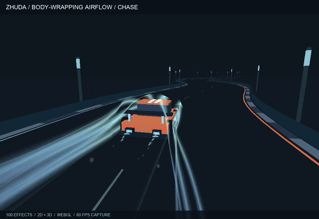
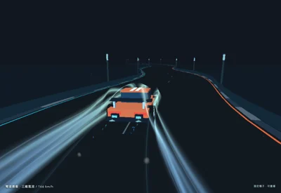
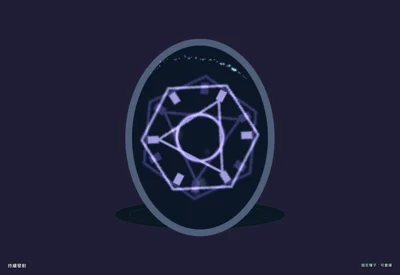
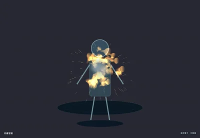
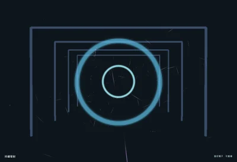

# Zhuda Particle Lab · 100 種場景粒子

**車頭起流、包覆整台車、彎道追尾。再來點魔法和爆破。**

[](https://zhudaandzhuer.github.io/zhuda-particle-lab/showcase.html)

**[▶ 觀看 60 FPS 展示影片](https://zhudaandzhuer.github.io/zhuda-particle-lab/showcase.html)** · **[立即玩 100 種效果](https://zhudaandzhuer.github.io/zhuda-particle-lab/)** · **[效果圖鑑](https://zhudaandzhuer.github.io/zhuda-particle-lab/catalog.html)** · [下載 MP4](https://zhudaandzhuer.github.io/zhuda-particle-lab/media/showcase-60fps.mp4)

[進階能力工作台](https://zhudaandzhuer.github.io/zhuda-particle-lab/capabilities.html) 以獨立頁面驗證溶解、折射、柔化深度、Bloom、Flipbook、碰撞事件、時間軸、預算與 Unity PBR 轉換；它使用引擎公開 SDK，不把場景或資產放入引擎倉庫。

[九種能力與 iPhone 14 實機驗收](VERIFICATION-CAPABILITIES.md) 包含畫面差異、JSON 編輯／重播、資源釋放與實測範圍。

100 種可調整的實用場景效果，涵蓋天氣、火煙、水體、地形生態、戰鬥、魔法、科技、介面回饋、慶典與 3D 動態。使用 [zhuda-laya-engine](https://github.com/zhudaandzhuer/zhuda-laya-engine) 的公開 SDK，直接在瀏覽器中以 WebGL 渲染。

| 效果庫 | 操作 | 已驗證 |
| --- | --- | --- |
| **10 類 × 10 種**：91 種 2D、9 種真實 3D | 搜尋、分類、調參、時間軸、三個 3D 視角、JSON 匯入匯出 | 100 種逐項渲染與重播、共用資源釋放、4,000 粒子負載 |

> 影片使用實際 WebGL 畫面逐幀錄製；MP4 為 **1280 × 880 / 60 FPS / 17 秒**。首頁 GIF 是較小的 24 FPS 預覽。命中特效會按段重播，沒有插幀補成 60 FPS。本機桌面效能量測與播放影片的幀率分開記錄，見 [驗收報告](VERIFICATION-100.md)。

## 精選場景

| 3D 賽車包覆氣流 | 傳送門與法陣 | 火球命中 | 3D 空間躍遷 |
| --- | --- | --- | --- |
| [](https://zhudaandzhuer.github.io/zhuda-particle-lab/?effect=racing3d) | [](https://zhudaandzhuer.github.io/zhuda-particle-lab/?effect=portal) | [](https://zhudaandzhuer.github.io/zhuda-particle-lab/?effect=fireball) | [](https://zhudaandzhuer.github.io/zhuda-particle-lab/?effect=warp3d) |

[完整 100 種用途清單](CATALOG.md) · [動畫與場景原始碼](src/) · [100 份個別效果 JSON](assets/effects/library/) · [錄影方式與逐段資料](docs/media/recording.json)

所有場景、配方、貼圖、車體與展示影片都在這個獨立應用程式中。通用粒子、三維 billboard 與 ribbon 能力由引擎提供。

## 本機啟動

需要 Node.js 24+。引擎版本固定為 `0ab067faff34ed2db47ec6e181b3e7931df68189`；瀏覽器執行時使用公開的 ESM SDK。

```sh
git clone https://github.com/zhudaandzhuer/zhuda-laya-engine.git Zhuda-LayaAir
git -C Zhuda-LayaAir checkout 0ab067faff34ed2db47ec6e181b3e7931df68189
npm --prefix Zhuda-LayaAir install
npm --prefix Zhuda-LayaAir run build

git clone https://github.com/zhudaandzhuer/zhuda-particle-lab.git Zhuda-ParticleLab
cd Zhuda-ParticleLab
npm run build
npm start
```

開啟 [http://localhost:8894/showcase.html](http://localhost:8894/showcase.html) 看影片、[http://localhost:8894/](http://localhost:8894/) 進入效果實驗室，或 [http://localhost:8894/capabilities.html](http://localhost:8894/capabilities.html) 驗證通用引擎能力。可設定 `ZHUDA_ENGINE_ROOT` 指向其他引擎目錄；`PORT` 可更換服務埠。預先產生的效果 JSON、貼圖縮圖與影片均已收錄，正常建置不需要錄影工具。

GitHub Actions 使用固定的引擎版本建置，通過全部瀏覽器驗證後才發布 GitHub Pages。

## Use

Search effect names or practical use cases, choose one of ten categories, or browse the visual index. Each effect has an eight-second preview: start at 0.7 s, stop emission at 5.6 s and let existing particles drain. One-shot hits naturally finish earlier. Pause, replay, seek or change density, velocity and lifetime. Applicable tail/ground switches are enabled only for effects with those layers. 3D effects have three camera views.

Individual assets are in `assets/effects/library/`; `catalog.json` maps IDs, titles, uses, dimensions and useful inspection times. `catalog-bundle.json` loads the entire library with one request. [CATALOG.md](CATALOG.md) lists all 100 effects.

Export/import preserves emitter settings plus `labPreview` for the 92 new library effects. This application metadata describes anchors, motion, context and zoom; it is interpreted by `src/LibraryScene.ts`, not by the engine itself. Copy that adapter or map its bindings to your own game objects. The underlying emitter descriptors work with the public 2D/3D particle APIs; texture keys must resolve to matching assets. `src/TextureFactory.ts` and `src/LibraryTextures.ts` generate the provided textures locally. Preview props and cameras are replaceable application code.

The original seven 2D presets retain their earlier emitter-only JSON behaviour. Racing JSON retains the vehicle preview; its authored body-flow paths are a separate `racing-airflow.json` asset. These eight legacy scenes remain available alongside the new library.

Invalid imports validate before replacing the current scene. Seeded fixed 120 Hz simulation makes seeking and replay reproducible. Simulation uses bounded pools; raising density/lifetime can reach a preset's pool limit.

## Verification

```sh
npm run verify
```

The full check includes all 100 effects plus the original 2D and racing regressions. `npm run verify:catalog` runs just the catalogue suite. Requires Google Chrome at its standard macOS path, or `CHROME_PATH`; set `LAB_URL` for another server.

`npm run verify:capabilities` checks the separate capability workbench in all nine modes, including actual WebGL submissions, collision events, material conversion, resource ownership and repeated scene switching.

For each effect the catalogue suite verifies real WebGL rendering, nonempty bounded particles, finite coordinates, reproducible replay, advancing animation and JSON roundtrip. New scenes also preserve their simulated positions after import. It captures on/off screenshots, checks category/search controls, rejects invalid data without losing the effect, checks drain/toggles/cameras, and performs 100 further mixed 2D/3D scene switches while checking bounded nodes and shared textures.

`npm run catalog:gallery` checks that every on/off pair has visible changed pixels, generates four contact sheets, 100 WebP thumbnails and `public/catalog.html`. Run `npm run build` afterwards to publish these locally. This optional evidence processing uses Python Pillow.

The original regressions cover curved world-space ribbons, full vehicle nose/roof/flank/wake coverage, progressive reveal, three cameras, graceful drain, shared-resource lifetime and a sustained 4,000-particle load. Reports and screenshots are written to `evidence/`.

CPU telemetry measures simulation and command submission, excluding GPU completion. Draw calls count actual WebGL functions; frame P95 includes browser/OS scheduling. Performance measurements apply to the tested desktop/browser. Preview screenshots represent selected moments, including the short lives of one-shot effects.

## Racing recording

`npm run record:3d` renders 480 independent frames for an eight-second 60 fps MP4 under `exports/`. `CAMERA=side` or `CAMERA=front` selects a different view. `RECORD_FPS` must divide the 120 Hz simulation step. Existing recording files are preserved.

## License & credits

MIT © 2026 豬大 / [zhudaandzhuer](https://github.com/zhudaandzhuer). Built with [zhuda-laya-engine](https://github.com/zhudaandzhuer/zhuda-laya-engine) and [LayaAir 3.4.2 / Layabox](https://layaair.com/). See [LICENSE](LICENSE) and [THIRD_PARTY_NOTICES.md](THIRD_PARTY_NOTICES.md).
