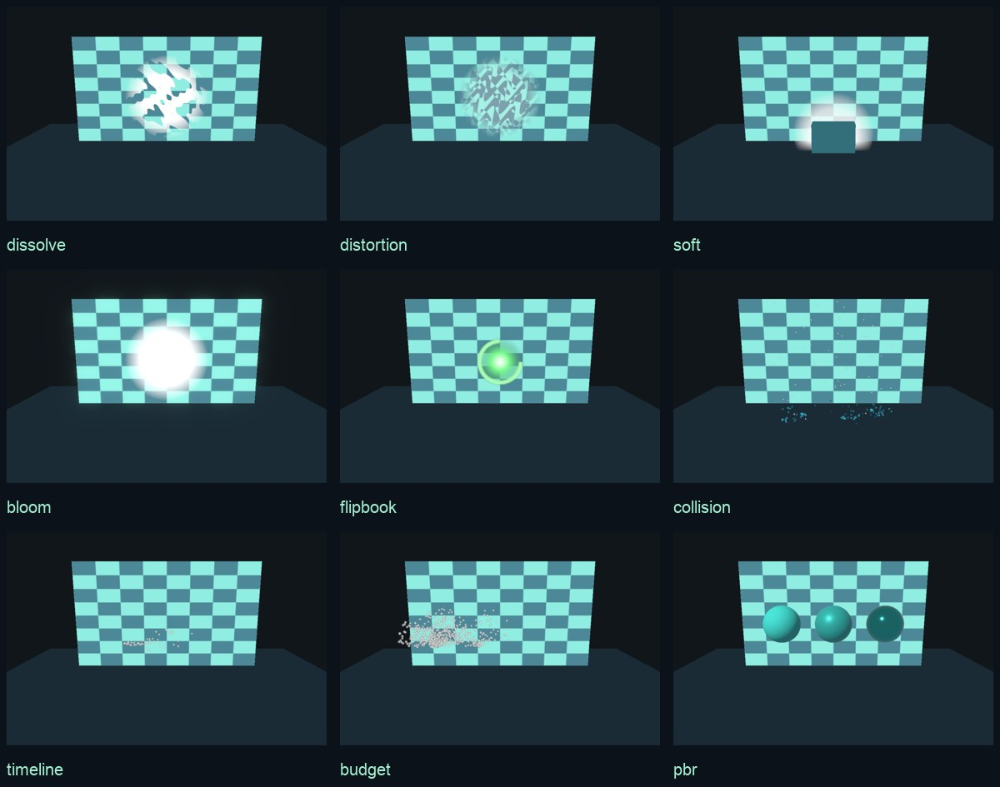

# 進階引擎能力驗證

2026-10-30（Asia/Taipei）。通用 SDK 位於獨立引擎倉庫；本倉庫只保存驗證場景、貼圖、編輯工作台與證據。



## 已驗證

| 層次 | 結果 |
| --- | --- |
| 引擎 | 型別檢查、Doctor、ESM/CJS 建置與 59 項測試通過；含嚴格 TypeScript 消費端、30/60/120 FPS 決定性、事件鏈拆除與未知 shader 阻擋。 |
| 桌面 Chrome | 九種模式都產生實際 WebGL draw calls，座標有限；碰撞產生子粒子、總預算不超過 600，PBR 材質保留三組金屬度。 |
| 畫面差異 | 固定時間／視角下，工作台舞台的溶解、背景折射、柔化交界、Flipbook 與 Bloom 開關均有超過 500 個 RGB 差異像素；比較區域不包含統計文字。 |
| 編輯與資源 | JSON 編輯後重播保留設定；錯誤設定不替換現有發射器；碰撞連結保留；24 次切場景後共用貼圖存活、根節點有界、相機額外 pass 恢復。工作台在 390 與 1440 像素寬度不橫向溢出。 |
| 原有應用 | 100 種效果、原有 2D／3D 回歸、4,000 粒子負載、展示影片與 repository subpath 連結均通過。 |
| iPhone 14 / Safari 27.0.1 | 真機九種模式通過；每種收集 60 個幀間隔樣本，P95 約 19–21 ms；WebGL draw calls 為 4–16。碰撞場景記錄到 27 次碰撞。 |

原始摘要：[桌面](docs/verification/capabilities-desktop.json)、[iPhone 14](docs/verification/capabilities-iphone14.json)。完整本機截圖、每幀 profiler 與瀏覽器報告位於忽略提交的 `evidence/`；CI 另保存驗證 artifact。

## 重現

```sh
npm run build
npm run verify:capabilities
npm run verify
npm run verify:publication
```

`CAPABILITIES_URL`、`LAB_URL` 與 `SHOWCASE_URL` 可指向發布站點；本機預設使用獨立測試服務與 repository subpath。需要 Chrome，Linux 可指定 `CHROME_PATH=/usr/bin/google-chrome`。

真機測試先啟動 `node scripts/device-check-server.mjs`，由同網路手機開啟 `http://<Mac-LAN-IP>:8898/capability-stage.html?devicecheck=1`。頁面自動跑九種能力並將實際資料回傳至本機 `evidence/devices/`；完成後停止服務。網址請使用手機剪貼簿貼上並核對。

## 驗證範圍

真機數字適用於這九個小型驗證場景，每種約 1.5–2 秒，不能推廣成所有效果、長時間遊玩或所有手機的效能保證。GPU 完成時間未量測。Android 本次未連線，沒有 Android 通過聲明。

桌面像素比較證明功能改變了畫面，沒有代表所有 Unity 資產已逐幀一致。材質轉換接受正規化的匯出資料；自訂 shader、加權動畫切線、貼圖通道／色彩空間仍須明確轉換或烘焙。碰撞目前為平面；背景折射只取不透明場景；透明物件交錯排序仍有近似。引擎 [API 文件](https://github.com/zhudaandzhuer/zhuda-laya-engine/tree/main/packages/core/effects) 列出具體契約與限制。
